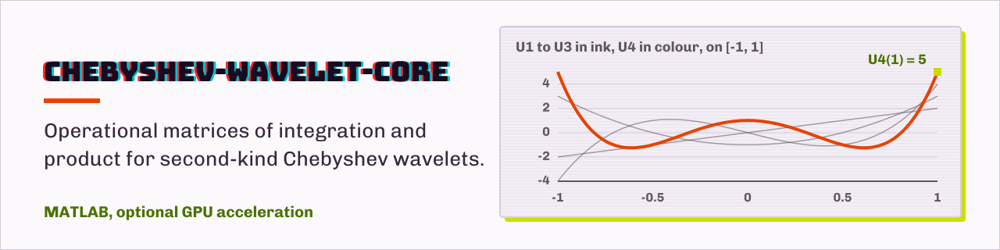
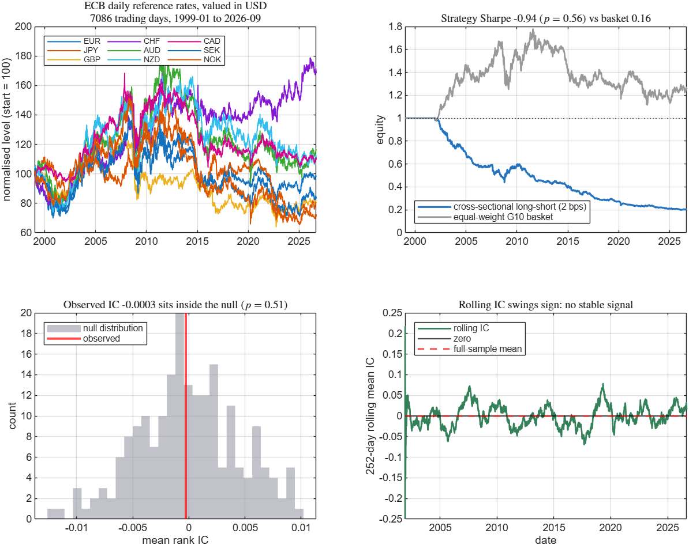

<p align="center">
  <picture><source media="(prefers-color-scheme: dark)" srcset="assets/banner-dark.svg"></picture>
</p>

# Chebyshev-Wavelet-Core

**English** · [繁體中文](README.zh-TW.md)

> MATLAB implementation of the **Operational Matrix of Integration (OMI)** and **Product Operation Matrix (POM)** for second-kind Chebyshev wavelets — generalised from the paper's single hand-computed case to arbitrary resolution and order, verified to zero error, and cross-checked against formal proofs.

[](https://github.com/heinricitorgau/Chebyshev-Wavelet-Core/actions/workflows/ci.yml)


[](https://doi.org/10.5556/j.tkjm.57.2026.5958)

Based on

> H. K. Nigam and M. M. Alam, *Convergence analysis of an efficient Chebyshev wavelet and its applications to differential equations via operational matrices of integration*, **Tamkang Journal of Mathematics** 57(3), 171–193 (2026). [doi:10.5556/j.tkjm.57.2026.5958](https://doi.org/10.5556/j.tkjm.57.2026.5958)

The paper writes out its operational matrix for one case by hand: a $16\times16$ matrix for
resolution $k=3$ and order $M=4$. This repository derives the matrices from first principles for
**any** $k$ and $M$, reproduces the paper's matrix exactly, solves its worked examples, and then
takes the basis somewhere the paper does not go — real financial data — to test whether it finds
anything there.

---

## Results at a glance

### 1. The paper's matrix is reproduced exactly — and its general formula corrected

The OMI built for $k=3,\ M=4$ matches the paper's Eq. (4.9) **element by element with zero error**,
with orthonormality and integration exactness at machine precision ($\sim10^{-16}$). Along the way
the derivation showed that the paper's *general* formulas, Eqs. (4.11)/(4.12), are inconsistent
with its own explicit matrix; the implementation follows the version that matches Eq. (4.9)
([details](docs/MATH.md#deviations-from-the-original-paper)).

<p align="center"></p>

### 2. It converges at the theoretical rate

Approximating $f(t)=e^{t}\sin(4t)$ with $M=4$, the $L^2$ error falls from $7.9\times10^{-2}$ to
$4.6\times10^{-9}$ as $k$ goes from 1 to 7 — a measured order of **4.00** per refinement, exactly the
theoretical $2^{M}$.

<p align="center"></p>

### 3. It solves the paper's differential equations

For the paper's Example 1, $y'+2y=t$, the computed coefficient $c_{1,0}=0.003866313244751$ matches
the printed value `0.00386631324475085`. With the product matrix handling a variable coefficient,
$y'+t\,y=t$ is solved to **$5.2\times10^{-16}$ — machine precision** — at $k=7,\ M=6$.

<p align="center"></p>

### 4. It is cross-checked against formal proofs

Key properties of the construction — the OMI's block coefficients, the Chebyshev-$U$
linearisation behind the POM, orthonormality, and the POM's projection characterisation — are
proved in Lean 4, and [`verify/verify_lean_agreement.m`](verify/verify_lean_agreement.m) compares
each proved closed form against the matrices MATLAB actually builds. Two correct tracks are not the
same as two *agreeing* tracks; this script is the bridge, and CI runs it on every change.

### 5. Case study: applied to real markets, it finds no tradeable signal

The same basis drives a financial time-series pipeline — causal denoising, walk-forward and
cross-sectional backtests on 27 years of G10 FX and 31 country/sector ETFs. The result is
negative, and the value is in how carefully that was established:

- **Look-ahead bias, measured:** non-causal wavelet features inflate out-of-sample accuracy by up
  to **7.5 percentage points on a pure random walk**; the causal features stay at 0.50.
- **G10 FX:** mean rank IC −0.0003 (p = 0.51) — the observed value sits in the middle of its null
  distribution.
- **31 ETFs:** greater breadth made the signal statistically real (IC +0.0319, p = 0.005), but it
  worked from 2001–2013 (Sharpe +0.43) and failed after (−0.60), and **simply holding the basket
  (+0.56) beats every strategy**.
- **The null tests themselves are calibrated**, and where they are not, the miscalibration is
  measured and documented rather than hidden.

<p align="center"></p>

The full study is in [docs/APPLICATIONS.md](docs/APPLICATIONS.md).

---

## Quick start

```matlab
cd path/to/chebyshev_wavelet_core
setup_paths

[P, ~, info] = build_chebyshev_matrices(3, 4, false, [], 'Verify', true);
disp(info.verify)          % paperEq49: 0  <- element-wise match with Eq.(4.9)

verify_lean_agreement      % Lean-proved formulas vs the matrices above
demo_omi_pom               % every figure in this README, a few minutes
```

Requires MATLAB R2021a or later and **no toolboxes**; a GPU is optional. The Python paper-trading
path needs Python 3.10+ and NumPy:

```bash
pip install numpy pytest
python -m pytest -q
```

---

## Documentation

| | |
| --- | --- |
| [**The mathematics**](docs/MATH.md) | Wavelet definition, OMI and POM derivations, numerical verification, deviations from the paper, the paper's examples, limitations, GPU benchmarks |
| [**Case study: financial time series**](docs/APPLICATIONS.md) | Denoising, causal features, walk-forward and cross-sectional backtests, real FX and ETF data, risk filter — and why each result does or does not count |
| [**Installation and usage**](docs/USAGE.md) | Requirements, `build_chebyshev_matrices` API reference, system architecture, project layout, the demo script |
| [Paper outline](docs/PAPER_OUTLINE.md) · [draft](docs/PAPER_DRAFT.md) | A methodology paper drawn from this repository |
| [Contributing](CONTRIBUTING.md) | How to propose a change |

---

## Citation

If this module is useful for your research, please cite the original paper:

```bibtex
@article{Nigam2026Chebyshev,
  author  = {Nigam, Hare Krishna and Alam, Md Mahtab},
  title   = {Convergence analysis of an efficient {C}hebyshev wavelet and its
             applications to differential equations via operational matrices
             of integration},
  journal = {Tamkang Journal of Mathematics},
  volume  = {57},
  number  = {3},
  pages   = {171--193},
  year    = {2026},
  doi     = {10.5556/j.tkjm.57.2026.5958}
}
```

To cite this implementation as well, use GitHub's **Cite this repository** button, which reads
[`CITATION.cff`](CITATION.cff).

## License

This project is licensed under the [MIT License](LICENSE), Copyright (c) 2026 Kao, En-Tsai.
