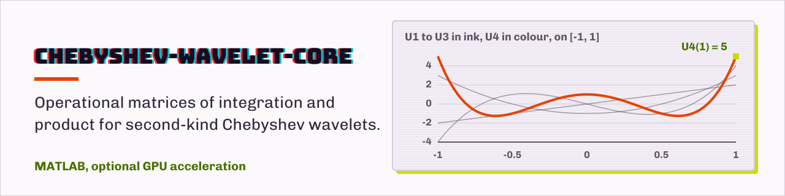
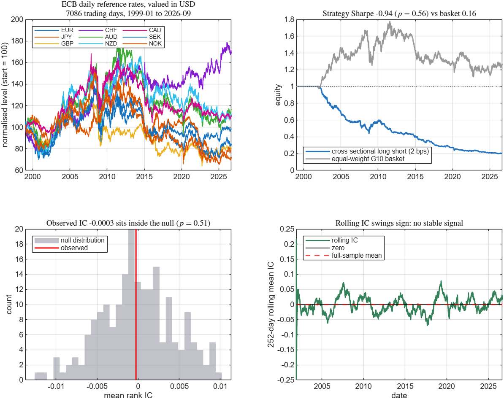

<p align="center">
  <picture><source media="(prefers-color-scheme: dark)" srcset="assets/banner-dark.svg"></picture>
</p>

# Chebyshev-Wavelet-Core

[English](README.md) · **繁體中文**

> 第二類 Chebyshev 小波的**積分運算矩陣（OMI）**與**乘積運算矩陣（POM）**之 MATLAB 實作：由論文唯一一個手算案例推廣到任意解析度與階數，驗證誤差為零，並與形式化證明交叉比對。

[](https://github.com/heinricitorgau/Chebyshev-Wavelet-Core/actions/workflows/ci.yml)


[](https://doi.org/10.5281/zenodo.24285430)
[](https://doi.org/10.5556/j.tkjm.57.2026.5958)

依據的論文：

> H. K. Nigam and M. M. Alam, *Convergence analysis of an efficient Chebyshev wavelet and its applications to differential equations via operational matrices of integration*, **Tamkang Journal of Mathematics** 57(3), 171–193 (2026). [doi:10.5556/j.tkjm.57.2026.5958](https://doi.org/10.5556/j.tkjm.57.2026.5958)

論文只手寫出一個案例的運算矩陣：解析度 $k=3$、階數 $M=4$ 的 $16\times16$ 矩陣。本 repo 從第一原理推導出**任意** $k$ 與 $M$ 的矩陣，精確重現論文的矩陣、解出論文的範例，接著把這組基底帶到論文沒有去過的地方——真實的金融資料——檢驗它在那裡能不能找到任何東西。

---

## 結果一覽

### 1. 精確重現論文的矩陣，並修正其通式

$k=3,\ M=4$ 所建構的 OMI 與論文 Eq. (4.9) **逐項比對誤差為零**，正交歸一性與積分精確性皆達機器精度（$\sim10^{-16}$）。推導過程中也發現論文的**通式** Eqs. (4.11)/(4.12) 與它自己寫出的矩陣互相矛盾；本實作採用與 Eq. (4.9) 一致的版本（[詳細說明](docs/MATH.zh-TW.md#與原論文的差異說明)）。

<p align="center"></p>

### 2. 以理論速率收斂

以 $M=4$ 近似 $f(t)=e^{t}\sin(4t)$，$k$ 由 1 增加到 7 時，$L^2$ 誤差由 $7.9\times10^{-2}$ 降到 $4.6\times10^{-9}$，每次加細的實測收斂階數為 **4.00**，與理論的 $2^{M}$ 完全一致。

<p align="center"></p>

### 3. 解出論文的微分方程

論文 Example 1 $y'+2y=t$ 算出的係數 $c_{1,0}=0.003866313244751$，與論文印出的 `0.00386631324475085` 相符。再用乘積矩陣處理變係數，$y'+t\,y=t$ 在 $k=7,\ M=6$ 下誤差為 **$5.2\times10^{-16}$，達到機器精度**。

<p align="center"></p>

### 4. 與形式化證明交叉比對

建構中的關鍵性質——OMI 的區塊係數、POM 背後的 Chebyshev-$U$ 線性化公式、正交歸一性，以及 POM 的投影特徵化——都已在 Lean 4 中證明，而 [`verify/verify_lean_agreement.m`](verify/verify_lean_agreement.m) 會把每個已證的閉式結果與 MATLAB 實際建構的矩陣逐項比對。兩軌各自正確不等於兩軌一致；這支腳本就是兩者之間的橋，CI 在每次變更時都會執行它。

### 5. 案例研究：用在真實市場上，沒有找到可交易的訊號

同一組基底也驅動一條金融時間序列管線：因果去噪、walk-forward 與橫斷面回測，資料涵蓋 27 年的 G10 外匯與 31 檔國家／產業 ETF。結果是負面的，而價值在於這個結論是多麼嚴謹地建立起來的：

- **前視偏誤的實測**：非因果的小波特徵在**純隨機漫步上**能把樣本外準確率灌水多達 **7.5 個百分點**；因果特徵則維持在 0.50。
- **G10 外匯**：平均 rank IC −0.0003（p = 0.51），觀測值正好落在虛無分布的中間。
- **31 檔 ETF**：廣度提高後訊號在統計上變成真的（IC +0.0319，p = 0.005），但它在 2001–2013 年有效（Sharpe +0.43），之後失效（−0.60），而且**直接持有整籃 ETF（+0.56）勝過所有策略**。
- **虛無檢定本身經過校準**；校準不完美的地方，偏差都被量測並寫進文件，而不是藏起來。

<p align="center"></p>

完整研究在 [docs/APPLICATIONS.zh-TW.md](docs/APPLICATIONS.zh-TW.md)。

---

## 快速開始

```matlab
cd path/to/chebyshev_wavelet_core
setup_paths

[P, ~, info] = build_chebyshev_matrices(3, 4, false, [], 'Verify', true);
disp(info.verify)          % paperEq49: 0  <- 與 Eq.(4.9) 逐項相符

verify_lean_agreement      % Lean 已證公式 vs 上面建構的矩陣
demo_omi_pom               % 產生本 README 的所有圖，約數分鐘
```

需要 MATLAB R2021a 以上，**不需要任何工具箱**；GPU 為選配。Python 模擬交易路徑需要 Python 3.10+ 與 NumPy：

```bash
pip install numpy pytest
python -m pytest -q
```

---

## 文件

| | |
| --- | --- |
| [**數學**](docs/MATH.zh-TW.md) | 小波定義、OMI 與 POM 的推導、數值驗證、與論文的差異、論文範例、限制、GPU 效能基準 |
| [**案例研究：金融時間序列**](docs/APPLICATIONS.zh-TW.md) | 去噪、因果特徵、walk-forward 與橫斷面回測、真實外匯與 ETF 資料、風險濾網，以及每個結果為何算數或不算數 |
| [**安裝與使用**](docs/USAGE.zh-TW.md) | 系統需求、`build_chebyshev_matrices` API 參考、系統架構、專案結構、示範腳本 |
| [論文綱要](docs/PAPER_OUTLINE.md) · [草稿](docs/PAPER_DRAFT.md) | 由本 repo 整理的方法論論文 |
| [貢獻指南](CONTRIBUTING.md) | 如何提出修改 |

---

## 引用

如果本模組對你的研究有幫助，請引用原論文：

```bibtex
@article{Nigam2026Chebyshev,
  author  = {Nigam, Hare Krishna and Alam, Md Mahtab},
  title   = {Convergence analysis of an efficient {C}hebyshev wavelet and its
             applications to differential equations via operational matrices
             of integration},
  journal = {Tamkang Journal of Mathematics},
  volume  = {57},
  number  = {3},
  pages   = {171--193},
  year    = {2026},
  doi     = {10.5556/j.tkjm.57.2026.5958}
}
```

如果也要引用這份實作，請使用 GitHub 側欄的 **Cite this repository** 按鈕，它讀取的是 [`CITATION.cff`](CITATION.cff)。每個版本都會存檔到 Zenodo，[doi:10.5281/zenodo.24285430](https://doi.org/10.5281/zenodo.24285430) 永遠指向最新版。

## 授權

本專案採用 [MIT License](LICENSE)，Copyright (c) 2026 Kao, En-Tsai.
