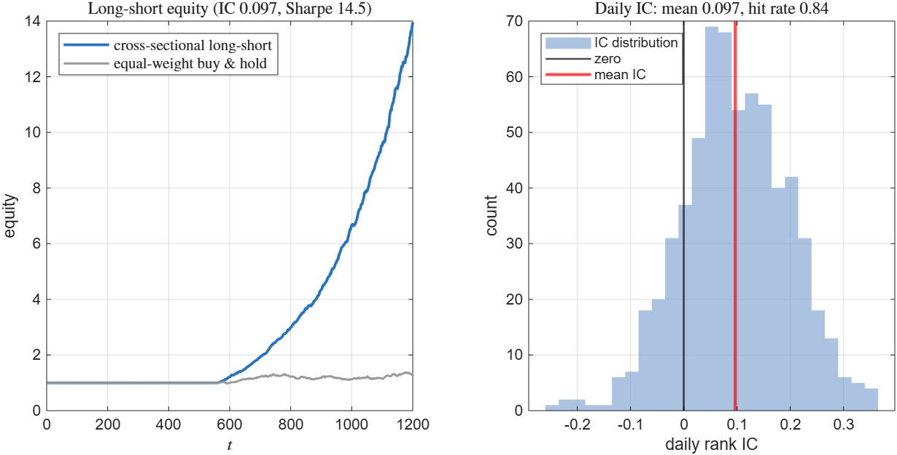
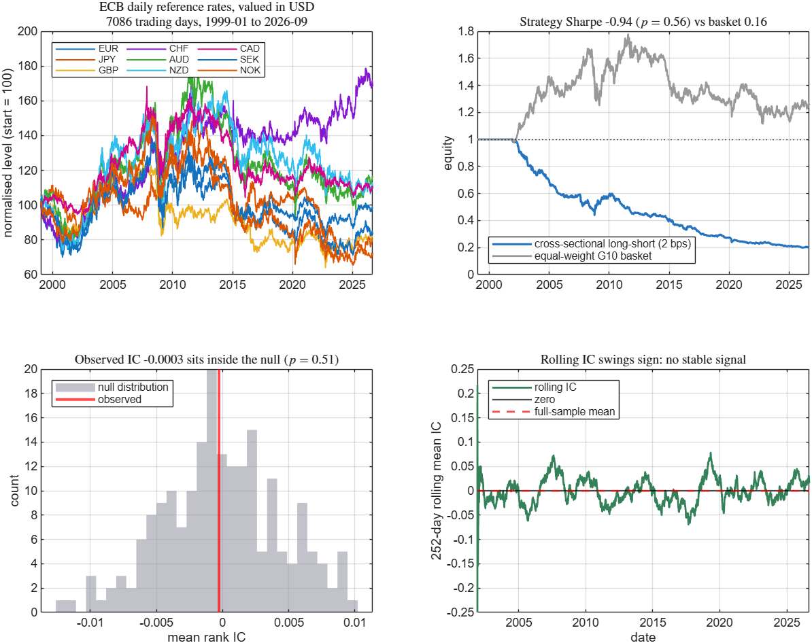
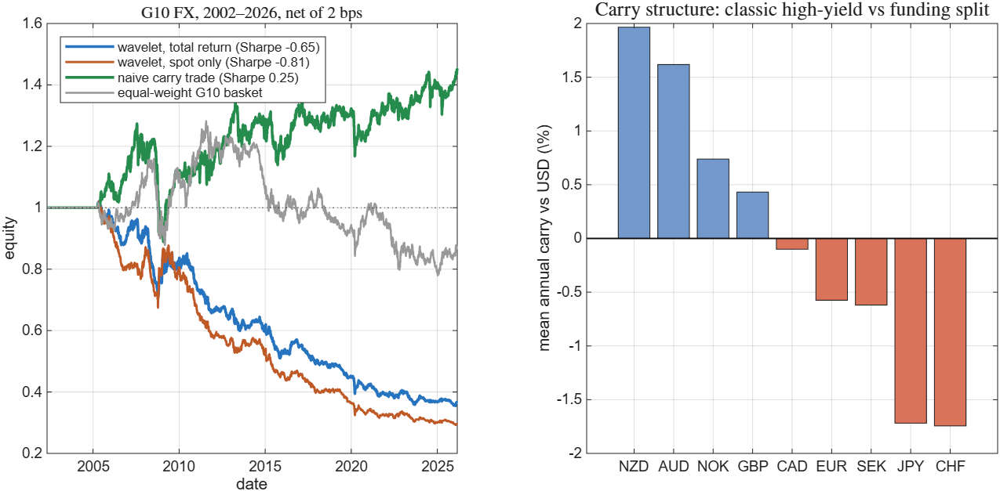

# Chebyshev-Wavelet-Core — 案例研究：金融時間序列

[English](APPLICATIONS.md) · **繁體中文** · [← 回到 README](../README.zh-TW.md)

把小波基底用在真實市場資料上，並附上決定結果是否有意義的驗證：因果特徵、經過校準的虛無檢定、成本與市場狀態分析。結論是負面的——沒有找到可交易的訊號——本文件記錄這個結論是如何得出的。管線所依據的數學在 [MATH.zh-TW.md](MATH.zh-TW.md)。

## 目錄

- [應用模組：金融時間序列去噪 wavelet_denoise_series](#應用模組金融時間序列去噪-wavelet_denoise_series)
- [應用模組：因果特徵萃取 wavelet_features](#應用模組因果特徵萃取-wavelet_features)
- [應用模組：預測模型與 walk-forward 回測 walkforward_backtest](#應用模組預測模型與-walk-forward-回測-walkforward_backtest)
- [應用模組：橫斷面多空回測 cross_sectional_backtest](#應用模組橫斷面多空回測-cross_sectional_backtest)
- [真實資料：外匯 load_fx_data](#真實資料外匯-load_fx_data)
- [真實資料：股票／國家 ETF load_etf_data](#真實資料股票國家-etf-load_etf_data)
- [風險濾網：wavelet_risk_filter](#風險濾網wavelet_risk_filter)

---

## 應用模組：金融時間序列去噪 `wavelet_denoise_series`

資料處理管線的第一步：將 1D（或多檔並排的 2D）時間序列投影至小波空間、濾除高頻雜訊，並同步輸出一階導數作為趨勢強弱特徵。

```matlab
[S_smooth, dS_dt, C, diagOut] = wavelet_denoise_series(S, T, k, M, Name, Value)
```

### 三個核心機制

**1. 投影**：時間軸正規化至 $\tau\in[0,1]$ 後，以 Gauss–Chebyshev 求積計算內積。因基底於各子區間支撐互斥，投影可逐區塊獨立進行，全程化為單一矩陣乘法 $(M\times Q)(Q\times L\cdot n_{\text{series}})$，無區塊或標的迴圈。

**2. 去噪**：平滑效果的主要來源是**維度縮減本身**（$\hat{N}=2^{k-1}M \ll n_{\text{obs}}$），另提供次數截斷 `'KeepDegree'` 與係數閾值 `'Threshold'` 兩種可疊加的機制。

**3. 一階導數**：微分將 $m$ 次多項式降為 $m-1$ 次，仍落在同一小波空間內，故存在**精確**的區塊對角微分矩陣 $D$，滿足 $\frac{d}{dt}\Psi(t)=D\,\Psi(t)$。由 $U'_m = 2\sum_{j=m-1,m-3,\dots}(j+1)U_j$ 得

$$D_{m,j} = 2^{k}\cdot 2(j+1),\qquad j = m-1,\, m-3,\, \dots$$

此處**不採用對 OMI 求逆**的作法：$P$ 的各區塊最後一列已捨去 $U_M$ 項，求逆會放大該截斷誤差與殘餘雜訊。$D$ 與 OMI 的一致性可由 $\int_0^t\Psi = P\Psi$ 兩側微分所得的恆等式驗證：

$$P\,D = I$$

實測在各區塊 $m\le M-2$ 的列上誤差為 **0**（機器精度），僅 $m=M-1$ 的列偏離恰好 1.0——正是 $P$ 所捨去的 $U_M$ 項。這是兩個模組數學一致性的交叉驗證。

### 實測基準

模擬價格（sine + random walk + 高斯雜訊，$n=750$、雜訊 std 1.2），30 次隨機實驗的平均 RMSE：

| 方法 | RMSE vs 真實訊號 |
|---|---|
| **k=4, M=4 純投影** | **0.284** |
| Savitzky–Golay (3, 41) | 0.292 |
| movmean(21) | 0.325 |
| k=5, M=4, `KeepDegree=2` | 0.330 |
| k=6, M=4, `Threshold='auto'` (hard) | 0.478 |
| 原始含噪資料 | 1.197 |

導數作為趨勢特徵：$k=4$ 時與真實導數的相關係數達 **0.996**，而直接對含噪資料取差分僅 0.122。


*上：去噪結果與真實訊號幾乎重合。中：殘差無結構，表示擬合良好。下：導數準確追蹤真實趨勢，但在子區間界點（虛線）有可見跳躍。*

### 兩點務必知悉的限制

**閾值化在此類資料上並未勝過純投影**（見上表）。原因是本基底屬**分段多項式迴歸基底**，雜訊能量分散於各多項式次數，而非如傳統多解析度小波般稀疏集中，Donoho–Johnstone 的稀疏性假設不成立。此選項預設關閉，保留給雜訊確實稀疏或含脈衝的情境。**請優先調整 $k$**，起始經驗值為每個子區間約 100 個資料點，即 $k \approx \log_2(n_{\text{obs}}/100)+1$。

**子區間界點不連續**：各 $\psi_{n,m}$ 支撐互斥且未施加接合條件，重建序列在 $L-1$ 個界點上會有跳躍。實測即使最佳參數仍達 std(S) 的 15–20%（上圖第三欄清楚可見），$k$ 過大時超過 30%（此時函數會發出警告）。`diagOut.maxBlockJumpRel` 會回報此量。若下游策略對界點附近的導數尖峰敏感，請設遮罩或改用具連續性約束的平滑器。

### 其他

支援 `datetime` / `duration` 時間軸（導數自動以「每日」為單位）、NaN 自動內插補值、非均勻取樣，以及 $n_{\text{obs}}\times n_{\text{series}}$ 的多標的矩陣輸入（多檔與逐檔迴圈結果一致，差異 $4.3\times10^{-14}$）。完整參數說明請執行 `help wavelet_denoise_series`。

---

## 應用模組：因果特徵萃取 `wavelet_features`

資料處理管線的第二步，也是接上預測模型前的必要環節。

```matlab
[F, featNames, causal, diagOut] = wavelet_features(S, T, Name, Value)
```

### 為什麼需要這一步

`wavelet_denoise_series` 把整段序列一次投影，時刻 $t$ 的平滑值用到了 $t$ **之後**的資料。作為事後分析與繪圖的工具沒有問題，但拿去餵預測模型就是典型的 look-ahead bias。本模組改以滾動視窗，確保時刻 $t$ 的特徵只用到 $S(1..t)$。

這不是理論顧慮。在**純幾何隨機漫步**上做次日漲跌方向預測（ridge、前 70% 訓練、後 30% 樣本外、40 次獨立實驗）——隨機漫步不具可預測性，樣本外準確率顯著高於 0.5 就只可能來自資料洩漏：

| 特徵來源 | 樣本外準確率 | 距 0.5 |
|---|---|---|
| **本模組（因果）** | **0.5007 ± 0.0038** | **+0.2 SE** |
| 批次去噪的斜率 | 0.5341 ± 0.0041 | +8.3 SE |
| 批次平滑值 − 收盤價 | 0.5630 ± 0.0033 | +18.8 SE |
| 上述兩者合用 | 0.5748 ± 0.0034 | +22.3 SE |

非因果特徵在毫無訊號的資料上可虛增最多 **7.5 個百分點**的樣本外準確率。反向驗證：改用含真實週期成分的序列，本模組特徵的樣本外準確率為 **0.7066 ± 0.0042**（多數類基準 0.5197）——無訊號時不捏造訊號，有訊號時抓得到。


*上：批次平滑器（紅）用到未來資料，曲線平滑但不可用於建模；因果平滑器（藍）只用過去資料，必然較晚反應。下：隨機漫步上的方向準確率，虛線以上的部分全部是洩漏。*

### 設計依據（兩項實測）

**預設 `Weighting='uniform'`**：論文的權函數 $w=\sqrt{1-x^2}$ 在 $x=\pm1$ 歸零，恰好把「最新的觀測值」權重壓到最低，對因果特徵不利。實測視窗右端的估計誤差，均勻最小平方較加權投影低約 25%：

| $W=63,\ M=4$ | 右端值 RMSE | 右端斜率 RMSE |
|---|---|---|
| uniform | **0.0449** | **0.819** |
| chebyshev | 0.0642 | 0.924 |

**預設 `k=1`**：本基底於子區間支撐互斥，故 $k\ge2$ 時「視窗右端的值與斜率只取決於最後一個子區間的 $W/2^{k-1}$ 個點」——實測改動視窗前半段資料，右端特徵變化量恰為 **0**。這使 $W$ 與 $k$ 在右端特徵上互相抵消，因此多尺度資訊改由多組**視窗長度** `'Windows'` 提供。

### 特徵集

每個視窗長度產生 6 個無因次特徵（預設 `Windows = [21 63 252]`，即 18 個特徵）：

| 特徵 | 定義 | 意義 |
|---|---|---|
| `trend` | $\dfrac{dS/d\tau}{S}$ | 一個視窗長度內的相對變化 |
| `trendT` | $\dfrac{dS/d\tau}{\sigma_{\text{res}}}$ | 以殘差標準差標準化的趨勢強度（類 $t$ 統計量） |
| `curv` | $\dfrac{d^2S/d\tau^2}{S}$ | 曲率／加速度，偵測趨勢轉折 |
| `dev` | $\dfrac{S(t)-\hat{S}(t)}{\sigma_{\text{res}}}$ | 標準化偏離（均值回歸訊號） |
| `vol` | $\dfrac{\sigma_{\text{res}}}{S}$ | 視窗內相對波動度 |
| `rough` | $\dfrac{\sum_{m\ge2}E_m}{\sum_{m\ge1}E_m}$ | 高次係數能量佔比（走勢非線性程度） |

導數同樣由區塊對角微分矩陣 $D$ 求得，二階導數即連續作用兩次：$\frac{d^2S}{d\tau^2}=\Psi^{T}(D^{T})^{2}C$。獨立逐點重算驗證，平滑值、`trend`、`curv` 的差異皆在 $10^{-13}$ 以下。

### 與預測目標的對齊

```matlab
[F, names] = wavelet_features(S, T);
y   = [sign(diff(S)); NaN];        % y(t) = 下一期漲跌方向
ok  = all(isfinite(F), 2) & isfinite(y);
Xtr = F(ok, :);   ytr = y(ok);
```

**切勿把 `F` 往前移以「對齊」標籤**——那會直接製造前視偏誤。切分訓練/測試集必須依時間先後（walk-forward），不可隨機切分。

`'Verify', true` 會執行因果性自我檢驗：擾動未來資料後，過去的特徵必須完全不變（`diagOut.leakTest` 應為 0，否則直接報錯）。

### 效能

視窗長度固定且觀測序號等距時，投影運算子對每個視窗完全相同，故先建構一次 $(N\times W)$ 的線性運算子，再以單一矩陣乘法作用於所有視窗，時間軸完全向量化。實測 20 檔 × 1500 筆共 18 個特徵約 0.27 秒；多標的與逐檔迴圈的結果差異 $3.5\times10^{-13}$。

---

## 應用模組：預測模型與 walk-forward 回測 `walkforward_backtest`

資料處理管線的第三步。以前進式的方式週期性重新訓練、只在未見過的區段產生預測，並內建虛無假設檢定以判斷績效是否僅為隨機。不依賴任何工具箱（ridge 為閉式解，logistic 以 IRLS 自行實作）。

```matlab
F   = wavelet_features(S, T);
res = walkforward_backtest(F, S, 'NullRuns', 200, 'CostBps', 5);
fprintf('準確率 %.4f (p = %.3f) | Sharpe %.2f (p = %.3f)\n', ...
    res.accuracy, res.null.pAccuracy, res.sharpe, res.null.pSharpe);
```

### 框架如何避免資料洩漏

1. **時間切分**：訓練集永遠位於測試集之前，絕不隨機切分。
2. **標準化只用訓練集統計量**：每次重新訓練時以該次訓練集的均值與標準差標準化。
3. **超參數只用訓練集**：測試段完全不參與選擇。
4. **標籤對齊**：位於 $t$ 的特徵預測 $t \to t+1$ 的報酬，部位於 $t$ 建立、$t+1$ 結算。
5. **空窗期**：訓練集結尾與測試段起點之間可留空窗（預設 1 期）。

兩項實測驗證：改動測試段**之後**的資料，先前的預測**0 / 489 筆**改變；把測試段的特徵尺度乘以 50，先前的預測**0 筆**改變（確認未使用全樣本統計量）。

### 虛無假設檢定與其校準

回測框架本身可能因多重比較或實作瑕疵產生虛假績效，因此本模組內建虛無分布：保持特徵不變，重組報酬序列以破壞特徵與標籤的對應，再以相同流程重跑。

**校準是必須驗證的**——校準不良的顯著性檢定比沒有檢定更危險。在 40 條純隨機漫步上（不具可預測性，故 p 值理論上應為均勻分布），每條 150 個虛無樣本：

| | `P(p<0.05)` | `P(p<0.10)` | `P(p<0.20)` | KS |
|---|---|---|---|---|
| 名目值 | 0.05 | 0.10 | 0.20 | — |
| `shift` 準確率 | 0.050 | 0.075 | 0.250 | 0.100 |
| `shift` Sharpe | 0.025 | 0.175 | 0.275 | 0.163 |
| **`block` 準確率** | 0.000 | 0.025 | 0.175 | 0.141 |
| **`block` Sharpe** | 0.025 | **0.050** | **0.200** | **0.072** |

`block`（區塊自助法，預設）的 Sharpe p 值幾乎完全均勻，準確率則偏保守；`shift`（循環位移）的 Sharpe 在 10% 水準偏樂觀。因 Sharpe 是實際決策依據，預設採 `block`。

### 為何預設固定 λ

開發過程中發現原本的「內部驗證選擇 λ」會破壞上述校準。兩項證據：

**λ 幾乎不影響績效**——跨六個數量級掃描，含訊號資料的樣本外準確率僅由 0.7048 變動到 0.7119，且內部驗證選中的值散布於整個網格，形同隨機挑選。

**λ 選擇會使 p 值系統性偏小**——同樣 40 條隨機漫步，唯一差異為是否選擇 λ：

| | `P(p<0.05)` 準確率 | `P(p<0.05)` Sharpe |
|---|---|---|
| 內部驗證選擇 λ | 0.100 | 0.125 |
| **固定 λ = 1** | **0.050** | **0.025** |

原因是虛無樣本沿用了「在真實標籤上調好的」超參數，使虛無模型相對吃虧。使用者若仍提供 λ 向量，本模組會在每個虛無樣本內以置換後的標籤重新選擇 λ 以維持對稱，但計算量顯著增加。


*左：隨機漫步上策略 Sharpe 0.46、$p=0.059$，觀測值落在虛無分布之內，且輸給買進持有。右：含真實訊號時觀測值遠在虛無分布之外。單次結果本就有約 5% 機率偶然顯著，故框架的可信度來自上面的校準表，而非任何單次結果。*

### 偵測力：這套框架能偵測到多弱的訊號

以報酬含 AR(1) 的合成序列測試（$n=2500$、12 次重複、每次 120 個虛無樣本）。$\phi$ 為日報酬的自我相關：

| $\phi$ | 準確率 | 策略 Sharpe | 買進持有 Sharpe | p 中位數 | 檢定力 |
|---|---|---|---|---|---|
| 0 | 0.5011 | 0.078 | 0.446 | 0.467 | **0.00** |
| 0.05 | 0.4973 | 0.172 | 0.368 | 0.512 | 0.17 |
| 0.10 | 0.5118 | 0.298 | 0.315 | 0.421 | 0.25 |
| 0.20 | 0.5359 | **1.487** | 0.602 | 0.012 | **0.83** |

兩個必須認清的結論：

1. **需要 $\phi \approx 0.20$ 才能穩定偵測到**（檢定力 0.83）；$\phi=0.05$ 時僅 0.17。真實股票日報酬的自我相關通常只有 0.00–0.05，**落在本框架偵測不到的區間**。
2. **$\phi \le 0.10$ 時策略 Sharpe 全都輸給買進持有**，要到 $\phi=0.20$ 才真正勝出。

這是單一序列在此樣本數下的統計極限，不是實作缺陷。要提升的方向是更長的歷史、更具預測力的特徵，或改走橫斷面（同時使用數百檔標的累積證據）——而非在同一條序列上反覆調參，那只會提高過度擬合的風險。

### 一個容易誤判的陷阱

**在有漂移的價格序列上，「準確率」與「Sharpe」都會獎勵單純做多。** 實測 λ 極大時模型退化為永遠預測多數類，得到準確率 0.5106、Sharpe 0.396，看似有技能，實則等同買進持有。因此正確的對照基準不是 0.5，而是 `res.baseline` 同時回報的多數類與買進持有績效。上圖左半即為一例：策略 Sharpe 0.46 看似為正，但同期買進持有更高。

---

## 應用模組：橫斷面多空回測 `cross_sectional_backtest`

資料處理管線的第四步，直接回應第三步偵測力分析所指出的限制。

```matlab
F   = wavelet_features(S, T);                 % S 為 nObs x nAssets 價格矩陣
res = cross_sectional_backtest(F, S, 'NullRuns', 200, 'CostBps', 5);
fprintf('IC %.4f (ICIR %.2f, p = %.3f) | Sharpe %.2f\n', ...
    res.meanIC, res.icir, res.null.pIC, res.sharpe);
```

### 為什麼橫斷面能突破單一序列的限制

`walkforward_backtest` 的偵測力分析顯示，單一序列在 $n=2500$ 下需要 $\phi \approx 0.20$ 才偵測得到，而真實股票僅 0.00–0.05。橫斷面從兩個方向改善：

1. **樣本數**：每個日期提供 $n_{\text{assets}}$ 個樣本，訓練樣本由 $O(T)$ 增為 $O(T \times n_{\text{assets}})$（實測 200 檔 × 2000 期得到 34.8 萬筆），標準誤縮小約 $\sqrt{n_{\text{assets}}}$ 倍。
2. **移除共同因子**：橫斷面標準化扣除當日市場成分。單一序列擇時必須預測市場方向（極難），橫斷面只需預測**相對排序**。

**同一份資料上的正面比較**（120 檔，注入 $\kappa=0.05$ 的橫斷面反轉訊號）：

| 方法 | 指標 | p 值 |
|---|---|---|
| **橫斷面多空** | IC +0.0947，Sharpe 14.38 | **0.010** |
| 單一序列擇時（6 檔平均） | 準確率 0.5165，Sharpe 0.54 | 0.109（不顯著） |
| 等權買進持有 | Sharpe 0.38 | — |

同一個訊號，橫斷面偵測得到，單一序列擇時偵測不到。



*左：多空組合淨值遠超等權買進持有。右：每日 rank IC 的分布，平均 0.097、勝率 0.84。*

> **這些 Sharpe 數字不可作為實盤預期。** 本節全部使用合成資料，注入的訊號強度遠高於真實市場，且未計入借券成本、流動性與衝擊成本。其意義僅在於證明「框架能偵測到它該偵測到的東西」。實務上月頻 IC 約 0.02–0.05 即屬可用訊號。

### 因果性與方法

- **目標**：橫斷面去均值並除以當日橫斷面標準差的次期報酬，使各日期尺度一致。
- **特徵標準化**：於「每個日期內、跨標的」進行（`rank` 或 `zscore`）。這只用到當日資料，**不涉及任何時序統計量，因此不引入前視偏誤**——雖然它使用了其他標的的資訊，但那些資訊在當下都是已知的。
- **模型**：彙總 (標的, 時間) 樣本的 ridge 迴歸，訓練/測試依時間切分。
- **評估**：以資訊係數 IC（預測分數與實際相對報酬的秩相關）為主，其優點是與組合建構方式無關；另回報 ICIR、IC t 統計量與勝率。

洩漏檢查：改動測試段之後的資料，先前的預測分數最大差異 **0.000e+00 / 56,040 筆**。

### 虛無假設檢定的校準（務必閱讀）

於「無橫斷面訊號」的合成面板上檢驗（p 值理論上應為均勻分布），50 次重複 × 100 個虛無樣本：

| | `P(p<0.05)` | `P(p<0.10)` | `P(p<0.20)` | KS | 平均 |
|---|---|---|---|---|---|
| 名目值 | 0.05 | 0.10 | 0.20 | — | 0.50 |
| `date` IC | 0.080 | 0.140 | 0.200 | 0.097 | 0.472 |
| `date` Sharpe | 0.040 | 0.160 | 0.220 | 0.073 | 0.486 |
| `asset` IC | 0.100 | 0.140 | 0.200 | 0.087 | 0.475 |
| `asset` Sharpe | 0.040 | 0.120 | 0.280 | 0.102 | 0.479 |

觀測 IC 為 $+0.00031 \pm 0.00062$，實質為零——未捏造訊號。整體分布接近均勻（KS 全數通過，臨界值 0.192；平均 p ≈ 0.48），**但 IC 的極左尾略為偏厚**：合併另一組 30 次獨立實驗後（共 80 個無訊號面板），IC 的 `P(p<0.05)` 約 0.10，即名目值的兩倍（約 2 個標準誤）；Sharpe 則落在雜訊範圍內。

**使用建議：IC 的 p 值在 0.05 附近應視為「邊際」而非結論**，建議改用較嚴格的門檻（如 0.01），或要求 IC 與 Sharpe 兩個 p 值同時顯著。我針對此偏移做過三輪調查（包含改用全域標的置換 `'asset'` 模式），兩種模式的校準差異在標準誤內，未能找到可修正的機制，因此選擇如實揭露而非隱藏。

### 效能

投影運算子與各折的 $X^TX$ 在虛無檢定中不變，故預先做 Cholesky 分解重複使用；並列平均秩與日期內置換皆已向量化。實測 200 檔 × 2000 期 × 18 特徵（機器閒置時）：回測 1.4 秒，虛無檢定每次約 0.74 秒（200 次約 2.5 分鐘）。虛無檢定的成本隨標的數與測試日期數成長，且對 CPU 競爭敏感——同一項量測在另一個 MATLAB 行程同時執行時為 1.67 秒。

---

## 真實資料：外匯 `load_fx_data`

前面所有章節都使用合成資料。本模組把管線接上真實市場：**歐洲央行每日參考匯率**，透過 [Frankfurter API](https://api.frankfurter.dev) 取得（免費、無需金鑰、無使用量限制，涵蓋 1999-01-04 至今）。首次取得後會快取於本機。

```matlab
[S, T, names] = load_fx_data();               % 7086 日 x 9 種 G10 貨幣
F   = wavelet_features(S, T, 'Windows', [21 63 252]);
res = cross_sectional_backtest(F, S, 'NullRuns', 200, 'CostBps', 2, ...
                               'MinAssets', 6, 'Quantile', 1/3);
```

### 計價幣轉換（本模組的核心設計）

ECB 只發布以歐元為基準的匯率。若直接把這些序列並排做橫斷面分析，所有序列都共用歐元這一腳，排序會被歐元強弱主導。因此本模組一律轉換為統一計價幣（預設美元）：

$$S_X(t) = \frac{\text{(numeraire per EUR)}(t)}{\text{(X per EUR)}(t)}$$

即「1 單位貨幣 $X$ 值多少計價幣」。對照 ECB 原始匯率驗證，EURUSD、USDJPY、GBPUSD 三組的換算誤差皆為 **0.000e+00**。

轉換後各序列共用的成分變成「美元因子」：實測日報酬相關矩陣的平均非對角元為 **0.512**。`cross_sectional_backtest` 的橫斷面去均值正好扣除此共同成分，剩下的才是各貨幣的相對強弱——這正是橫斷面模組所需的輸入形式。

### 使用前必須知道的兩件事

**即期匯率不等於總報酬。** 外匯總報酬 = 即期變動 + 兩國利差（carry）。ECB 參考匯率**不含利差**，而對外匯而言 carry 往往是主要成分，足以主導多空策略的全部損益。此處計算的任何 Sharpe 都是「純即期報酬」，不是可實現的交易報酬。若要評估可交易策略，必須另行取得各幣別的短天期利率（如 OIS）並加回利差。

**這是定盤參考價，不是可成交報價。** ECB 參考匯率為每日 CET 16:00 左右定盤，既非收盤價、也無買賣價差資訊。實際交易成本需透過 `'CostBps'` 另行設定。

### 實測結果：未找到可交易訊號

全樣本、6334 個樣本外交易日、200 次虛無檢定：

| 指標 | 0 bps | 2 bps |
|---|---|---|
| 平均 rank IC | −0.0003（ICIR −0.00, t = −0.06, p = 0.512） | 同左 |
| Sharpe | −0.15（p = 0.796） | **−0.94**（p = 0.557） |
| IC 勝率 | 0.495 | 0.495 |
| 周轉 | 1.03 / 日 | 1.03 / 日 |
| 等權 G10 籃子買進持有 | Sharpe +0.16 | — |



*左上：九種 G10 貨幣以美元計價的走勢。右上：策略持續虧損，被動籃子則否。左下：觀測 IC 落在虛無分布正中央。右下：252 日滾動 IC 在 −0.25 至 +0.22 間擺盪，僅 46.3% 的時間為正——沒有穩定訊號。*

單一貨幣擇時的結果一致：EUR / JPY / GBP 的準確率分別為 0.5093 / 0.5044 / 0.4976，p 值皆不顯著——與偵測力分析的預測相符，真實外匯的自我相關太弱，在這個樣本數下偵測不到。

另外，周轉 1.03/日代表組合幾乎每天全部換手，在 2 bps 下年化成本約 **5.2%**。光是這一項就足以吃掉任何現實強度的訊號。

### 一個看似顯著、實則不是的子期間結果

把樣本對半切開後出現這個結果：

| 期間 | IC | p(IC) | Sharpe | p(Sharpe) |
|---|---|---|---|---|
| 1999–2012 | −0.0020 | 0.616 | −0.94 | 0.636 |
| 2013–2026 | **+0.0123** | **0.026** | −0.82 | 0.291 |

p = 0.026 看起來像個發現。但基於三個獨立的理由，它不是：

1. **多重比較。** 測了兩個子期間，Bonferroni 調整後的門檻為 0.025——連這個最低限度的修正都通不過。
2. **已記錄的校準偏移。** 如[虛無檢定校準](#虛無假設檢定的校準務必閱讀)所實測，本模組 IC 的 p 值左尾偏厚，`P(p<0.05)` ≈ 0.10 約為名目值兩倍。名目上的 0.026 實際上更接近 0.05。
3. **內部不一致。** IC 為正，但同期 Sharpe 是**負的**（−0.82，p = 0.291）。排序「正確」卻在賠錢，就不是可交易的訊號。本專案自己訂下的規則——要求 IC 與 Sharpe 兩個 p 值同時顯著——直接否決了它。

這正是這些防護機制當初要攔截的偽陽性，因此把它記錄下來，而不是當成發現來報告。

### 補上利差：`load_fx_carry` 與 `'ReturnType','total'`

外匯總報酬 = 即期變動 + 利差，因此純即期回測是不完整的。`load_fx_carry` 從 FRED（免費、無需金鑰）取得 OECD 三個月期同業拆款利率，`load_fx_data('ReturnType','total')` 據以建構總報酬指數：

$$\mathrm{TRI}_X(t) = \mathrm{TRI}_X(t-1)\cdot\frac{S_X(t)}{S_X(t-1)}\cdot\left(1 + (i_X - i_{\text{num}})\,\Delta t\right)$$

建構的三項驗證：

- **算術**：實測（總報酬 − 即期）的年化差與平均 carry 相差 **0.006 個百分點**。
- **經濟直覺**：相對美元的平均年化 carry 為 NZD +1.97%、AUD +1.62%、NOK +0.74%（做多方）與 CHF −1.74%、JPY −1.72%、SEK −0.62%（融資方）——教科書式的高息／融資貨幣分野。
- **因果性**：OECD 月值是「當月平均」，於當月使用會構成前視偏誤，故模組預設將公布時點落後一個月（`'LagMonths'`）；設為 0 會發出警告。

樣本代價：利率序列的共同起點為 2002-05（受 JPY 限制），故總報酬樣本為 6103 日，而純即期為 7086 日。

### 結果：carry 有幫助，但小波訊號仍未增添任何東西

以下皆已扣除 2 bps 成本，且使用相同的 2002–2026 期間：

| 策略 | Sharpe | IC | p(IC) |
|---|---|---|---|
| 小波橫斷面，**純即期** | −0.81 | −0.0004 | 0.532 |
| 小波橫斷面，**總報酬** | −0.65 | +0.0051 | 0.144 |
| **純 carry 交易**（依利差排序，不用小波） | **+0.25** | — | — |
| 等權 G10 籃子 | −0.04 | — | — |



*左：加入 carry 後小波策略上移（橘 → 藍），但仍持續虧損；唯一向上的是最單純的 carry 交易（綠）。右：各貨幣的 carry 結構。*

carry 讓小波策略在方向上改善——IC 由 −0.0004 升至 +0.0051、Sharpe 由 −0.81 升至 −0.65——但仍舊虧損且不顯著。相對地，最簡單的已知因子（單純依利差排序）就取得正的 Sharpe。

**周轉是決定性差異**：小波策略周轉 0.926/日，純 carry 交易 0.0039/日，相差 **240 倍**。carry 排序幾乎不變（政策利率以月為單位變動），年化成本僅 0.02%，而小波策略約 4.7%。訊號必須非常強才可能在這種成本下存活。

誠實的結論：**在真實 G10 外匯上，這套小波趨勢特徵相對於最簡單的已知因子沒有增添任何東西。**

### 另一個解讀陷阱：虧損策略也會出現顯著的 p 值

2014–2026 的總報酬子期間得到 Sharpe = −0.44、**p = 0.040**，看起來顯著。檢視虛無分布即可解釋：其平均為 −1.055、95% 區間 [−1.721, −0.354]。虛無分布中的**每一個**策略都付同樣的高周轉成本，因此整個分布都遠低於零。觀測值 −0.44 贏過其中多數，故 p 值很小——但策略依然在賠錢。

p 值小代表「比隨機好」，不代表「有獲利」。當成本高到把虛無分布推到負值時，這兩件事差很多。

### 把 carry 當特徵：小波在已知因子之上是否增添價值？

自然的下一步是把 carry 直接餵進模型當特徵，而非只當對照基準。這不需要修改任何模組——特徵陣列為 `nObs × nFeat × nAssets`，利差沿第 2 維串接即可：

```matlab
Fw    = wavelet_features(S, T, 'Windows', [21 63 252]);   % 18 個小波特徵
Fc    = reshape(carryDiff, nObs, 1, nAssets);             % 1 個 carry 特徵
Fboth = cat(2, Fw, Fc);                                   % 19 個
```

跑三組對照可回答一個精確的問題：「carry + 小波」減去「僅 carry」，就是小波特徵的**增量價值**。

| 設定 | Sharpe | IC | p(IC) | maxDD | 偏態 | 周轉 |
|---|---|---|---|---|---|---|
| **僅 carry**（1 個特徵） | **+0.27** | +0.0397 | 0.005 | 0.304 | −0.63 | 0.004 |
| 僅小波（18 個特徵） | −0.65 | +0.0051 | 0.144 | 0.653 | −0.28 | 0.926 |
| carry + 小波（19 個特徵） | −0.18 | +0.0279 | 0.005 | 0.464 | −0.65 | 0.491 |

**把小波特徵加到 carry 上會破壞它**：Sharpe 由 +0.27 掉到 −0.18。18 個雜訊特徵稀釋了唯一有訊號的那一個，並使周轉上升 123 倍（0.004 → 0.491），年化成本由 0.02% 增至約 2.5%。

子期間一致性也指向同一結論——只有 carry 在兩段期間都站得住：

| 設定 | 2002–2013 | 2014–2026 |
|---|---|---|
| 僅 carry | +0.31 | +0.34 |
| 僅小波 | −0.65 | −0.44 |
| carry + 小波 | −0.32 | −0.12 |

另請注意，carry + 小波的 IC **顯著**（p = 0.005）、Sharpe 的 p 值也顯著，卻仍在賠錢——正是前述「虛無分布被成本壓成負值」的同一個陷阱。

### 但「僅 carry」也不是穩定的策略

若以投資（而非訊號）的標準檢視，僅 carry 策略在每一個穩定性維度上都不合格：

| 指標 | 僅 carry 策略 |
|---|---|
| 年化報酬 | **+2.2%** |
| 年化波動 | 8.1% |
| Sharpe | 0.27 |
| 最大回撤 | **30.4%**（2007-07 → 2009-01） |
| 回撤復原所需時間 | **4.0 年**（1010 個交易日） |
| 最差年度 | **−21.8%**（2008） |
| 正報酬年份 | 23 年中 15 年（65%） |
| 報酬偏態 | −0.63 |

決定性的問題在於它**何時**虧損。2008 年危機期間它虧 −14.4%，而被動等權 G10 籃子虧 −14.8%——**在最需要分散的時候幾乎沒有提供任何分散效果**。2020 年它虧 −6.1%、籃子僅 −3.4%；2015 年人民幣貶值它虧 −3.6%、籃子僅 −0.6%。它與其他資產同時崩跌，這正是 carry 交易的教科書式失效模式，與穩定恰好相反。

作為對照，全球股票長期 Sharpe 約 0.40–0.50，60/40 組合約 0.50–0.60——**兩者皆為被動配置，不需要任何訊號、選股或擇時**。

**結論**：在 G10 外匯上，小波特徵相對於最簡單的已知因子沒有增添價值，與之結合時反而有害。carry 本身確實存在但很弱，其報酬型態不符合任何合理的「穩定投資」定義。[偵測力分析](#偵測力這套框架能偵測到多弱的訊號)所指出的瓶頸——標的數太少、廣度不足——並非在同一組資料上繼續調參所能解決。

---

## 真實資料：股票／國家 ETF `load_etf_data`

外匯的研究指出瓶頸在廣度：9 種貨幣太少。本模組把廣度提高到 **31 檔國家與產業 ETF**（2001-08 至 2026-09，6293 個交易日），資料取自 Yahoo Finance 的 chart API（免費、無需金鑰）。

```matlab
[S, T, names] = load_etf_data();          % 31 檔 ETF，已股息調整
F   = wavelet_features(S, T, 'Windows', [21 63 252]);
res = cross_sectional_backtest(F, S, 'NullRuns', 200, 'CostBps', 5, ...
                               'RebalanceEvery', 21);
```

### 為何用 ETF 而非個股：存活者偏誤

這是股票橫斷面的頭號陷阱。以「今日的指數成分股」回溯歷史，只會保留同時通過兩道篩選的公司：活到今天、且今天仍在指數內。破產、下市、被併購、被剔除者全部消失，使美股回測績效每年虛增約 1~4 個百分點——遠大於所尋找的訊號強度。更麻煩的是，**這個偏誤存在於資料本身，本專案所有的虛無檢定都攔不住它**。要真正避免需要 point-in-time 的成分股歷史，而免費資料源並不提供。

國家與產業 ETF 大幅迴避了這個問題：這類基金極少清算、標的池穩定。但偏誤**並非為零**——標的池仍取自今日存續的基金，歷史上確實有 ETF 被清算。殘餘偏誤應遠小於個股，但不應宣稱完全不存在。

### 股息調整是必要的，不是可選項

實測標的池的隱含年化配息率跨越 **1.08%（XLK）至 4.25%（EWM）**，價差 3.2 個百分點，歐亞國家型基金在上、美國成長類股在下。若使用未調整的收盤價，此價差會直接進入橫斷面排序成為假訊號。這與外匯必須加回 carry 完全是同一類問題。本模組預設回傳股息調整後價格。

### 廣度奏效：訊號在統計上變成真的

| 標的池 | 標的數 | 小波平均 IC | p(IC) |
|---|---|---|---|
| G10 外匯 | 9 | +0.0051 | 0.144 |
| **國家／產業 ETF** | **31** | **+0.0319** | **0.005** |

廣度提高 3.4 倍後，橫斷面 IC 由偵測不到變為明確顯著——正是[偵測力分析](#偵測力這套框架能偵測到多弱的訊號)所預測的。

### 每日再平衡正在摧毀訊號

每日再平衡時每一組都大幅虧損（僅小波 Sharpe −0.63）。原因是周轉而非訊號：**1.989/日，在 5 bps 下年化成本約 25%**。IC 在各再平衡頻率下完全相同，變的只有成本：

| 設定 | 再平衡 | Sharpe | 周轉 | 年化成本 |
|---|---|---|---|---|
| 僅小波 | 每日 | −0.63 | 1.989 | 25.1% |
| 僅小波 | 每月 | +0.10 | 0.149 | 1.9% |
| 僅小波 | 每季 | +0.16 | 0.051 | 0.6% |
| 動能 + 小波 | 每月 | **+0.22** | 0.146 | 1.8% |

這暴露了 `cross_sectional_backtest` 的一個真實限制：先前強制每日再平衡，對任何高周轉訊號等同判死刑，而且會偽裝成「訊號無效」。新增的 `'RebalanceEvery'` 選項使兩者可以分離；設為 1 可精確重現先前行為。

### 但它仍然不是可用的策略

每月再平衡加 200 次虛無檢定後，最佳組合表面上很有希望——Sharpe +0.22、p(Sharpe) = 0.020、p(IC) = 0.005、61% 年份正報酬、最大回撤 0.279、偏態為正。但有三個獨立理由否定它：

| 設定 | 2001–2013 | 2014–2026 |
|---|---|---|
| 僅小波 | +0.40 | **−0.68** |
| 僅動能 | −0.05 | −0.14 |
| 動能 + 小波 | +0.43 | **−0.60** |

1. **全樣本數字是跨越了體制轉變的平均值。** +0.22 完全來自前半段，最後 12 年是 −0.60。這是曾經有效然後失效的策略，不是穩定的策略。（橫斷面動能於 2009 年後衰減在文獻上有記載，故此失效模式符合現實而非程式錯誤。）
2. **規格搜尋。** +0.22 是自 12 個組合（3 組特徵 × 4 種再平衡頻率）中選出的最大值。以 12 次比較做 Bonferroni 調整，名目 p = 0.020 變為約 0.24——不顯著。且本模組的 IC p 值[左尾偏厚](#虛無假設檢定的校準務必閱讀)。
3. **被動持有勝出。** 等權買進持有同樣這 31 檔 ETF 的 Sharpe 為 **+0.56**，超過最佳策略的兩倍，且不需模型、不需訊號、沒有周轉。

**結論**：提高廣度讓訊號在統計上可偵測，修正再平衡頻率讓它不再是災難——但它既不跨體制穩定，也贏不過單純持有籃子。

---

## 風險濾網：`wavelet_risk_filter`

方向性研究撞上了體制穩定性的牆。本模組將小波特徵由「排序訊號」改為「曝險控制」，疊加於被動的等權 ETF 配置之上。

動機是統計上的：本專案實測日報酬的自我相關僅 0.00~0.05，但 |報酬| 的自我相關達 0.2~0.4。波動叢聚的可預測性遠高於方向。

```matlab
[S, T] = load_etf_data();
e      = wavelet_risk_filter(S, T, 'Verify', true);   % 因果曝險，值域 [0,1]
```

曝險以波動率目標化決定，$e(t)=\min(1,\ \sigma_{\text{target}}(t)/\hat\sigma(t))$，其中 $\sigma_{\text{target}}(t)$ 取 $\hat\sigma$ 於 $[1,t-1]$ 的**擴張視窗中位數**——目標由歷史自行決定而非人工設定常數，且平均曝險自然接近 1。因果性已強制並自我檢驗（`leakTest = 0`）。

### 缺此兩項對照則結論必然失真

任何降險機制都會同時降低回撤與報酬，故：

- **等波動度基準**：先把買進持有縮放至相同已實現波動再比較。否則「回撤變小」只是槓桿較低，不是技巧。
- **與平庸估計對照**：問題不是「波動率目標化有沒有用」（已知對回撤有幫助），而是「小波的波動估計是否勝過一行 EWMA 遞迴」。這與先前以 carry、動能為基準是同一套紀律。

### 結果：疊加層有效，但小波沒有貢獻

31 檔 ETF，2001-08 至 2026-09，每單位曝險變動扣 5 bps：

| 策略 | Sharpe | 年化 % | 波動 % | maxDD % | 偏態 |
|---|---|---|---|---|---|
| 買進持有 | +0.56 | +10.97 | 19.70 | 58.7 | −0.26 |
| **買進持有，縮放 0.68×（等波動）** | **+0.56** | +7.46 | 13.39 | **43.7** | −0.26 |
| **EWMA 濾網** | **+0.67** | +8.88 | 13.32 | **32.9** | −0.56 |
| 小波濾網 | +0.67 | +8.91 | 13.39 | 36.0 | −0.52 |

相對於**等波動度**基準，疊加層將 Sharpe 由 +0.56 提升至 +0.67、最大回撤由 43.7% 降至 36.0%，且在**相同波動度下年化報酬多出 1.45 個百分點**。以區塊自助法重排曝險路徑（保留其邊際分布與持續性）的虛無檢定確認並非運氣：觀測 Sharpe 0.666 對虛無 0.515 ± 0.057（p = 0.007），觀測 maxDD 0.360 對 0.533 ± 0.042（p = 0.007）。

**這是本專案第一個真正正面的結果。** 但它同時也最清楚地顯示，產生這個結果的並不是小波：

| 小波 vs EWMA | |
|---|---|
| Sharpe 差異 | −0.001 |
| maxDD 差異 | +3.2 個百分點（小波較差） |
| 曝險路徑相關 | **0.960** |
| σ 對未來 21 日已實現波動的預測相關 | 0.632（小波） vs **0.670**（EWMA） |
| 同上，log 尺度 | 0.643 vs **0.675** |
| σ 中位數水準（實際已實現 13.7%） | 15.2% vs **14.0%** |

小波的波動估計在預測力上略遜於一行 EWMA，水準校準也較差。小波獨有、EWMA 沒有對應物的 `rough` 特徵（高次係數能量）只讓 Sharpe 提升 +0.022，回撤反而變差，且門檻為人工挑選——屬規格搜尋，不構成發現。

### 關於穩定性的誠實但書

| | 2001–2013 | 2014–2026 |
|---|---|---|
| 買進持有 | +0.51 | **+0.64** |
| 小波濾網 | **+0.76** | +0.57 |
| EWMA 濾網 | **+0.78** | +0.55 |

疊加層的優勢集中在危機密集的前半段。在較平靜的後半段，它反而略遜於等波動度的買進持有——這正是波動率目標化的預期行為：在波動飆升時發揮價值，在持續多頭中則犧牲報酬。另註 Moreira & Muir (2017) 報告了波動率管理組合的效益，但 Cederburg et al. (2020) 指出其樣本外相當脆弱；此領域的正面結果不如表面穩固。

**結論**：波動率目標化是真實且值得保留的降低回撤工具。但 Chebyshev 小波對它沒有任何超越兩行 EWMA 的貢獻。
