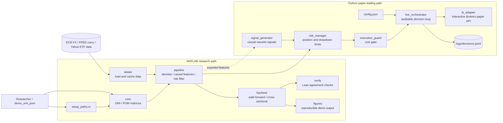

# Chebyshev-Wavelet-Core — installation and usage

**English** · [繁體中文](USAGE.zh-TW.md) · [← back to the README](../README.md)

Requirements, installation, the `build_chebyshev_matrices` API, the system architecture and the project layout. The results are in [MATH.md](MATH.md) and [APPLICATIONS.md](APPLICATIONS.md).

## Contents

- [System Requirements](#system-requirements)
- [Installation](#installation)
- [Quick Start](#quick-start)
- [API Reference](#api-reference)
- [System Architecture](#system-architecture)
- [Project Structure](#project-structure)

---

## System Requirements

| Item | Requirement |
|---|---|
| MATLAB | **R2021a or later** (name-value syntax in `arguments` blocks) |
| Required Toolboxes | None (pure MATLAB core functions) |
| GPU Acceleration | Parallel Computing Toolbox + CUDA-compatible GPU (**optional**) |
| Memory | Default limit 24 GB, suitable for 32 GB machines; adjustable via `'MemoryLimitGB'` |
| Python paper-trading path (**optional**) | Python 3.10+ and NumPy; `--source ib` also needs `ib_async` (`pip install ib_async`) |

When the Parallel Computing Toolbox is not installed or no GPU is available, setting `use_gpu = true` will issue a warning and automatically fall back to CPU without interrupting execution.

---

## Installation

Source files live in subfolders, so add them all with the bundled helper:

```matlab
cd path/to/chebyshev_wavelet_core
setup_paths            % adds core/ pipeline/ backtest/ dataio/ demos/
setup_paths('save')    % same, but persisted via savepath
```

`setup_paths` resolves paths from its own location, so it works from any working directory. The demo bootstraps its own paths, so `demo_omi_pom` also runs without calling `setup_paths` first.

---

## Quick Start

The fastest way to get started is to run the demo script (covers construction, verification, convergence, ODE solving, and performance measurement):

```matlab
demo_omi_pom
```

Below are minimal examples for individual features:

```matlab
%% 1. Paper case k = 3, M = 4, with self-verification
[P, ~, info] = build_chebyshev_matrices(3, 4, false, [], 'Verify', true);
disp(info.verify)
%        paperEq49: 0              <- element-wise match with Eq.(4.9)
%   orthonormality: 3.3573e-16
% integrationExactness: 1.1102e-16

%% 2. Build the Product Operation Matrix (POM) for f(t) = t
E = info.expand(@(t) t);                       % Paper Eq.(5.5)
[P, Ftilde] = build_chebyshev_matrices(3, 4, false, E);

%% 3. GPU single-precision acceleration (for large matrix operations on high-frequency data)
Pg = build_chebyshev_matrices(10, 8, true, [], 'Precision', 'single');
class(Pg)      % gpuArray
A  = Pg * Pg;  % computed on GPU

%% 4. Sparse format for very large problems
[Ps, ~, is] = build_chebyshev_matrices(13, 8, false, [], 'Format', 'sparse');
fprintf('N = %d, density = %.4f\n', is.N, nnz(Ps)/is.N^2);   % N = 32768, density = 0.0313
```

---

## API Reference

```matlab
[P, Ftilde, info] = build_chebyshev_matrices(k, M, use_gpu, C, Name, Value)
```

### Positional Arguments

| Argument | Type | Default | Description |
|---|---|---|---|
| `k` | positive integer | — | Wavelet resolution; number of subintervals $L=2^{k-1}$ |
| `M` | positive integer | — | Polynomial order, $m=0,\dots,M-1$ |
| `use_gpu` | logical | `false` | Whether to construct and keep on GPU via `gpuArray` |
| `C` | double vector | `[]` | Coefficient vector of length $\hat{N}=2^{k-1}M$; POM is computed only when provided |

### Name-Value Options

| Name | Values | Default | Description |
|---|---|---|---|
| `'Format'` | `'full'` \| `'sparse'` | `'full'` | Sparse format saves ~$4M\times$ memory (see [Limitations](MATH.md#numerical-properties--known-limitations)) |
| `'Precision'` | `'double'` \| `'single'` | `'double'` | Consumer GPUs have much higher FP32 than FP64 throughput; `'single'` is recommended for high-frequency data |
| `'MemoryLimitGB'` | positive number | `24` | Raises an error if exceeded to prevent out-of-memory or system paging |
| `'Verify'` | logical | `false` | Runs self-verification; results are stored in `info.verify` |

### Outputs

| Output | Description |
|---|---|
| `P` | Operational Matrix of Integration (OMI), $\hat{N}\times\hat{N}$ block upper-triangular matrix |
| `Ftilde` | Product Operation Matrix (POM), block-diagonal; returns `[]` when `C` is not provided |
| `info` | Struct with fields listed below |

`info` fields:

| Field | Description |
|---|---|
| `.N` `.L` `.k` `.M` | Matrix dimension $\hat{N}$, number of subintervals $L$, input parameters |
| `.alpha` | Scale constant $\alpha=2^{k/2}\sqrt{2/\pi}$ |
| `.Mblk` `.Nblk` | $M\times M$ diagonal / off-diagonal blocks |
| `.Lambda` | $M\times M\times M$ third-order linearization tensor $\Lambda_{i,j,l}$ |
| `.basis` | `@(t)` evaluates $\Psi(t)$, returning $\hat{N}\times$`numel(t)` |
| `.expand` | `@(fh)` projects a function onto the basis as coefficient vector $C$ (Gauss–Chebyshev quadrature) |
| `.device` `.precision` `.format` `.bytes` | Build environment and memory usage |
| `.timeOMI` `.timePOM` | Construction time for each phase (seconds) |
| `.verify` | Verification results (when `'Verify', true`) |

---

## System Architecture

The repository has two connected paths: the MATLAB research path for constructing and evaluating wavelet signals, and the Python paper-trading path for applying causal signals with explicit cost and risk gates. The Python path is disabled from submitting orders by default.



The main dependency direction is `dataio -> pipeline -> backtest`; `core` supplies the mathematical operators used by the pipeline, while `verify` and `figures` provide independent evidence and reproducible outputs. The Python layer is intentionally separated from MATLAB backtests and keeps order submission behind the cost guard and paper-trading adapter.

---

## Project Structure

```
chebyshev_wavelet_core/
├── core/
│   ├── build_chebyshev_matrices.m   % Paper core: OMI and POM
│   └── project_root.m               % Resolves the package root (path safety)
├── pipeline/
│   ├── wavelet_denoise_series.m     % Denoising and trend features (batch)
│   ├── wavelet_features.m           % Causal feature extraction (for models)
│   └── wavelet_risk_filter.m        % Risk/volatility filter (exposure control)
├── backtest/
│   ├── walkforward_backtest.m       % Single-series prediction & backtesting
│   ├── cross_sectional_backtest.m   % Cross-sectional long-short backtesting
│   └── *_sensitivity.m, subperiod_stability.m, universe_resampling.m  % Robustness studies
├── dataio/
│   ├── load_fx_data.m               % ECB daily FX reference rates
│   ├── load_fx_carry.m              % G10 short rates (carry) via FRED
│   └── load_etf_data.m              % 31 country/sector ETFs via Yahoo
├── demos/
│   └── demo_omi_pom.m               % Demo script (12 sections, see below)
├── verify/
│   ├── verify_lean_agreement.m      % Lean-proved formulas vs the MATLAB build
│   └── run_ci_checks.m              % What CI runs: checkcode, Eq.(4.9), Lean agreement
├── docs/
│   ├── MATH.md                      % The mathematics, verification and paper examples
│   ├── APPLICATIONS.md              % Case study: financial time series
│   ├── USAGE.md                     % This file
│   ├── *.zh-TW.md                   % Traditional Chinese versions
│   └── PAPER_OUTLINE.md, PAPER_DRAFT.md  % Methodology-paper outline and draft
├── figures/                         % Figures for the README and docs (generated by the demo)
│   ├── fig_basis.png
│   ├── fig_structure.png
│   ├── fig_convergence.png
│   ├── fig_example1.png
│   ├── fig_varcoef.png
│   ├── fig_denoise.png
│   ├── fig_causal.png
│   ├── fig_backtest.png
│   ├── fig_crosssection.png
│   ├── fig_fx_real.png
│   └── fig_fx_carry.png
├── data/                            % Fetched data caches (gitignored)
├── chebyshev_wavelet_py/            % Python paper-trading path (see System Architecture)
├── tests/                           % Python tests (pytest)
├── run_sandbox.py                   % Paper-trading decision sandbox
├── config.json                      % Python path configuration
├── setup_paths.m                    % Adds all subfolders to the MATLAB path
├── .github/workflows/ci.yml         % CI: MATLAB R2021a + latest, Python 3.10 + 3.12
├── CITATION.cff                     % Citation metadata ("Cite this repository")
├── CLAUDE.md                        % Project guide for Claude Code
├── README.md                        % Overview and headline results (English)
├── README.zh-TW.md                  % Traditional Chinese
└── LICENSE
```

Figures can be regenerated at any time: set `EXPORT_PNG` to `true` at the top of `demo_omi_pom.m` and run it — figures will be exported to `figures/`. (Figure text is in English, since MATLAB's default font does not include CJK characters and Chinese labels would render as boxes in exported PNGs.)

### Demo Script

```matlab
demo_omi_pom      % Run in full, or execute section-by-section with Ctrl+Enter
```

| Section | Content |
|---|---|
| 1 | Build OMI and verify element-wise against paper Eq. (4.9); visualize block upper-triangular structure |
| 2 | Visualize the 16 basis functions $\psi_{n,m}(t)$ |
| 3 | Convergence order verification (measured $2^{4.00}\times$ error reduction per $k$ increment, matching theory $2^M$) |
| 4 | POM block-diagonal structure and truncation effects when product degree exceeds basis order |
| 5 | Paper Example 1: $y'+2y=t$, with error convergence for $k=3\dots6$ |
| 6 | Variable-coefficient ODE $y'+ty=t$: practical application of POM |
| 7 | Sparse format and CPU/GPU performance measurement |
| 8 | Financial time-series denoising and trend features (`wavelet_denoise_series`), with $k$ parameter sweep |
| 9 | Causal feature extraction and look-ahead bias quantification (`wavelet_features`), 20 random experiments |
| 10 | Prediction model and walk-forward backtesting (`walkforward_backtest`), with null distribution |
| 11 | Cross-sectional long-short backtesting (`cross_sectional_backtest`), signal strength sweep |
| 12 | Real FX data (`load_fx_data`) — skipped automatically if no cache exists, keeping the demo runnable offline |
