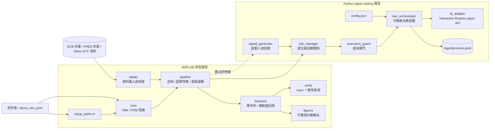

# Chebyshev-Wavelet-Core — 安裝與使用

[English](USAGE.md) · **繁體中文** · [← 回到 README](../README.zh-TW.md)

系統需求、安裝、`build_chebyshev_matrices` API、系統架構與專案結構。結果在 [MATH.zh-TW.md](MATH.zh-TW.md) 與 [APPLICATIONS.zh-TW.md](APPLICATIONS.zh-TW.md)。

## 目錄

- [系統需求](#系統需求)
- [安裝](#安裝)
- [快速開始](#快速開始)
- [API 參考](#api-參考)
- [系統架構](#系統架構)
- [專案結構](#專案結構)

---

## 系統需求

| 項目 | 需求 |
|---|---|
| MATLAB | **R2021a 以上**（`arguments` 區塊之 name-value 語法） |
| 必要工具箱 | 無（純 MATLAB 核心函式） |
| GPU 加速 | Parallel Computing Toolbox + CUDA 相容顯示卡（**選用**） |
| 記憶體 | 預設上限 24 GB，適用 32 GB 主機；可由 `'MemoryLimitGB'` 調整 |
| Python 模擬交易路徑（**選用**） | Python 3.10 以上與 NumPy；`--source ib` 另需 `ib_async`（`pip install ib_async`） |

未安裝 Parallel Computing Toolbox 或無可用 GPU 時，`use_gpu = true` 會發出警告並自動回退至 CPU，不會中斷執行。

---

## 安裝

程式碼分置於數個子目錄，請以內附的輔助函數一次加入：

```matlab
cd path/to/chebyshev_wavelet_core
setup_paths            % 加入 core/ pipeline/ backtest/ dataio/ demos/
setup_paths('save')    % 同上，並以 savepath 永久保存
```

`setup_paths` 以自身位置推得路徑，故從任何工作目錄呼叫皆可運作。示範腳本會自行加入路徑，因此 `demo_omi_pom` 也可在未執行 `setup_paths` 時直接呼叫。

---

## 快速開始

最快的入門方式是直接執行示範腳本（涵蓋建構、驗證、收斂性、解 ODE 與效能量測）：

```matlab
demo_omi_pom
```

以下為個別功能的最小範例：

```matlab
%% 1. 論文情形 k = 3, M = 4，並執行自我驗證
[P, ~, info] = build_chebyshev_matrices(3, 4, false, [], 'Verify', true);
disp(info.verify)
%        paperEq49: 0              <- 與論文 Eq.(4.9) 逐項相同
%   orthonormality: 3.3573e-16
% integrationExactness: 1.1102e-16

%% 2. 建立 f(t) = t 對應的乘積運算矩陣 POM
E = info.expand(@(t) t);                       % 論文 Eq.(5.5)
[P, Ftilde] = build_chebyshev_matrices(3, 4, false, E);

%% 3. GPU 單精度加速（適合高頻資料的大量矩陣相乘）
Pg = build_chebyshev_matrices(10, 8, true, [], 'Precision', 'single');
class(Pg)      % gpuArray
A  = Pg * Pg;  % 在 GPU 上運算

%% 4. 超大型問題改用稀疏格式
[Ps, ~, is] = build_chebyshev_matrices(13, 8, false, [], 'Format', 'sparse');
fprintf('N = %d, 密度 = %.4f\n', is.N, nnz(Ps)/is.N^2);   % N = 32768, 密度 = 0.0313
```

---

## API 參考

```matlab
[P, Ftilde, info] = build_chebyshev_matrices(k, M, use_gpu, C, Name, Value)
```

### 位置引數

| 引數 | 型別 | 預設 | 說明 |
|---|---|---|---|
| `k` | 正整數 | — | 小波解析度，子區間數 $L=2^{k-1}$ |
| `M` | 正整數 | — | 多項式階數，$m=0,\dots,M-1$ |
| `use_gpu` | logical | `false` | 是否以 `gpuArray` 建構並保留於 GPU |
| `C` | double 向量 | `[]` | 長度 $\hat{N}=2^{k-1}M$ 的係數向量；提供時才計算 POM |

### 名稱－值選項

| 名稱 | 可選值 | 預設 | 說明 |
|---|---|---|---|
| `'Format'` | `'full'` \| `'sparse'` | `'full'` | 稀疏格式約可省下 $4M$ 倍記憶體（見[限制](MATH.zh-TW.md#數值特性與已知限制)） |
| `'Precision'` | `'double'` \| `'single'` | `'double'` | 消費級 GPU 的 FP32 吞吐量遠高於 FP64，高頻資料建議 `'single'` |
| `'MemoryLimitGB'` | 正數 | `24` | 超過即報錯，避免 out-of-memory 或系統換頁 |
| `'Verify'` | logical | `false` | 執行自我驗證，結果寫入 `info.verify` |

### 輸出

| 輸出 | 說明 |
|---|---|
| `P` | 積分運算矩陣 OMI，$\hat{N}\times\hat{N}$ 區塊上三角矩陣 |
| `Ftilde` | 乘積運算矩陣 POM，區塊對角矩陣；未提供 `C` 時為 `[]` |
| `info` | 結構體，欄位如下 |

`info` 欄位：

| 欄位 | 說明 |
|---|---|
| `.N` `.L` `.k` `.M` | 矩陣階數 $\hat{N}$、子區間數 $L$、輸入參數 |
| `.alpha` | 尺度常數 $\alpha=2^{k/2}\sqrt{2/\pi}$ |
| `.Mblk` `.Nblk` | $M\times M$ 之對角／離對角區塊 |
| `.Lambda` | $M\times M\times M$ 三階線性化張量 $\Lambda_{i,j,l}$ |
| `.basis` | `@(t)` 求值 $\Psi(t)$，回傳 $\hat{N}\times$`numel(t)` |
| `.expand` | `@(fh)` 將函數投影為係數向量 $C$（Gauss–Chebyshev 求積） |
| `.device` `.precision` `.format` `.bytes` | 建構環境與記憶體用量 |
| `.timeOMI` `.timePOM` | 各階段建構耗時（秒） |
| `.verify` | `'Verify',true` 時的驗證結果 |

---

## 系統架構

本 repository 有兩條相互銜接的路徑：用於建構與評估小波訊號的 MATLAB 研究路徑，以及以因果訊號搭配明確成本與風險閘門的 Python paper-trading 路徑。Python 路徑預設停用下單功能。



主要依賴方向是 `dataio -> pipeline -> backtest`；`core` 提供 pipeline 使用的數學運算子，而 `verify` 與 `figures` 提供獨立驗證及可重現輸出。Python 層與 MATLAB 回測分離，且下單必須經過成本閘門與 paper-trading adapter。

---

## 專案結構

```
chebyshev_wavelet_core/
├── core/
│   ├── build_chebyshev_matrices.m   % 論文核心：OMI 與 POM
│   └── project_root.m               % 取得套件根目錄（路徑安全）
├── pipeline/
│   ├── wavelet_denoise_series.m     % 去噪與趨勢特徵（批次）
│   ├── wavelet_features.m           % 因果特徵萃取（供建模使用）
│   └── wavelet_risk_filter.m        % 風險／波動度濾網（曝險控制）
├── backtest/
│   ├── walkforward_backtest.m       % 單一序列預測與回測
│   ├── cross_sectional_backtest.m   % 橫斷面多空回測
│   └── *_sensitivity.m, subperiod_stability.m, universe_resampling.m  % 穩健性研究
├── dataio/
│   ├── load_fx_data.m               % ECB 外匯每日參考匯率
│   ├── load_fx_carry.m              % G10 短期利率（carry），來源 FRED
│   └── load_etf_data.m              % 31 檔國家／產業 ETF，來源 Yahoo
├── demos/
│   └── demo_omi_pom.m               % 示範腳本（12 個章節，見下）
├── verify/
│   ├── verify_lean_agreement.m      % Lean 已證公式 vs MATLAB 實際建構的矩陣
│   └── run_ci_checks.m              % CI 執行的檢查：checkcode、Eq.(4.9)、Lean 一致性
├── docs/
│   ├── MATH.md                      % 數學、驗證與論文範例
│   ├── APPLICATIONS.md              % 案例研究：金融時間序列
│   ├── USAGE.md                     % 安裝與使用（本檔為中文版）
│   ├── *.zh-TW.md                   % 繁體中文版
│   └── PAPER_OUTLINE.md, PAPER_DRAFT.md  % 方法論論文綱要與草稿
├── figures/                         % README 與 docs 所用圖檔（由示範腳本產生）
│   ├── fig_basis.png
│   ├── fig_structure.png
│   ├── fig_convergence.png
│   ├── fig_example1.png
│   ├── fig_varcoef.png
│   ├── fig_denoise.png
│   ├── fig_causal.png
│   ├── fig_backtest.png
│   ├── fig_crosssection.png
│   ├── fig_fx_real.png
│   └── fig_fx_carry.png
├── data/                            % 抓取的資料快取（已 gitignore）
├── chebyshev_wavelet_py/            % Python 模擬交易路徑（見系統架構）
├── tests/                           % Python 測試（pytest）
├── run_sandbox.py                   % 模擬交易決策沙盒
├── config.json                      % Python 路徑設定
├── setup_paths.m                    % 一次加入所有子目錄至搜尋路徑
├── .github/workflows/ci.yml         % CI：MATLAB R2021a + 最新版、Python 3.10 + 3.12
├── CITATION.cff                     % 引用資訊（「Cite this repository」）
├── CLAUDE.md                        % 給 Claude Code 的專案指引
├── README.md                        % 概覽與主要結果（英文）
├── README.zh-TW.md                  % 繁體中文
└── LICENSE
```

圖檔可隨時重新產生：將 `demo_omi_pom.m` 開頭的 `EXPORT_PNG` 設為 `true` 後執行，即會輸出至 `figures/`（圖表文字採英文，因 MATLAB 預設字型不含 CJK 字元，中文標籤在匯出的 PNG 中會顯示為方框）。

### 示範腳本

```matlab
demo_omi_pom      % 完整執行，或在編輯器中以 Ctrl+Enter 逐節執行
```

| 章節 | 內容 |
|---|---|
| 1 | 建構 OMI 並與論文 Eq.(4.9) 逐項比對，繪製區塊上三角結構 |
| 2 | 16 個基底函數 $\psi_{n,m}(t)$ 視覺化 |
| 3 | 函數逼近收斂階數驗證（實測每提高一階 $k$ 誤差降低 $2^{4.00}$ 倍，符合理論 $2^M$） |
| 4 | POM 的區塊對角結構，及「乘積次數是否超出基底」造成的截斷效應對照 |
| 5 | 論文 Example 1：$y'+2y=t$，並列出 $k=3\dots6$ 的誤差收斂 |
| 6 | 變係數 ODE $y'+ty=t$：POM 的實際應用 |
| 7 | 稀疏格式與 CPU/GPU 效能量測 |
| 8 | 金融時間序列去噪與趨勢特徵（`wavelet_denoise_series`），含 $k$ 的參數掃描 |
| 9 | 因果特徵萃取與前視偏誤量化（`wavelet_features`），20 次隨機實驗 |
| 10 | 預測模型與 walk-forward 回測（`walkforward_backtest`），含虛無分布 |
| 11 | 橫斷面多空回測（`cross_sectional_backtest`），訊號強度掃描 |
| 12 | 真實外匯資料（`load_fx_data`）——無快取時自動略過，維持離線可執行 |
